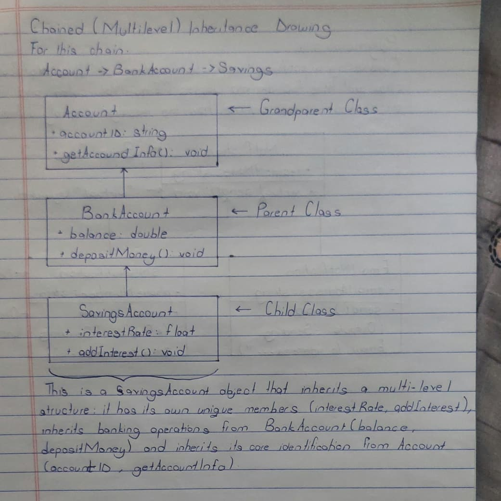

# Chained Inheritance

## Hand-Drawn Illustration

## Explanation
This program demonstrates multilevel inheritance. `Account` is the grandparent class. `BankAccount` inherits from `Account`. `SavingsAccount` inherits from `BankAccount`. The `SavingsAccount` object in `main()` can call functions from all three classes.