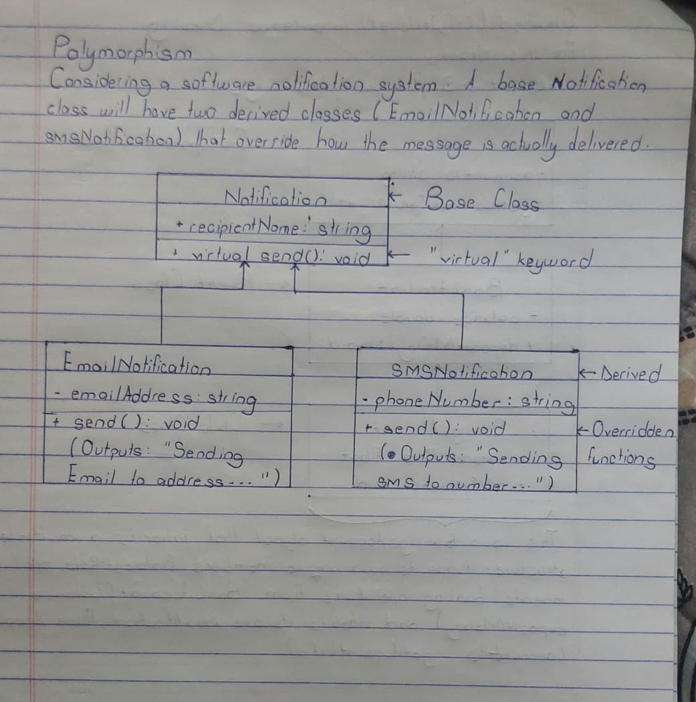

# Polymorphism

## Hand-Drawn Illustration

## Explanation
This program demonstrates runtime polymorphism. The base class `Notification` has a `virtual send()` function. The derived classes `EmailNotification` and `SMSNotification` override it. In `main()`, we use a vector of base-class pointers (`Notification*`). When we call `send()` in a loop, the program dynamically figures out which object is being pointed to and calls the correct overridden version.s